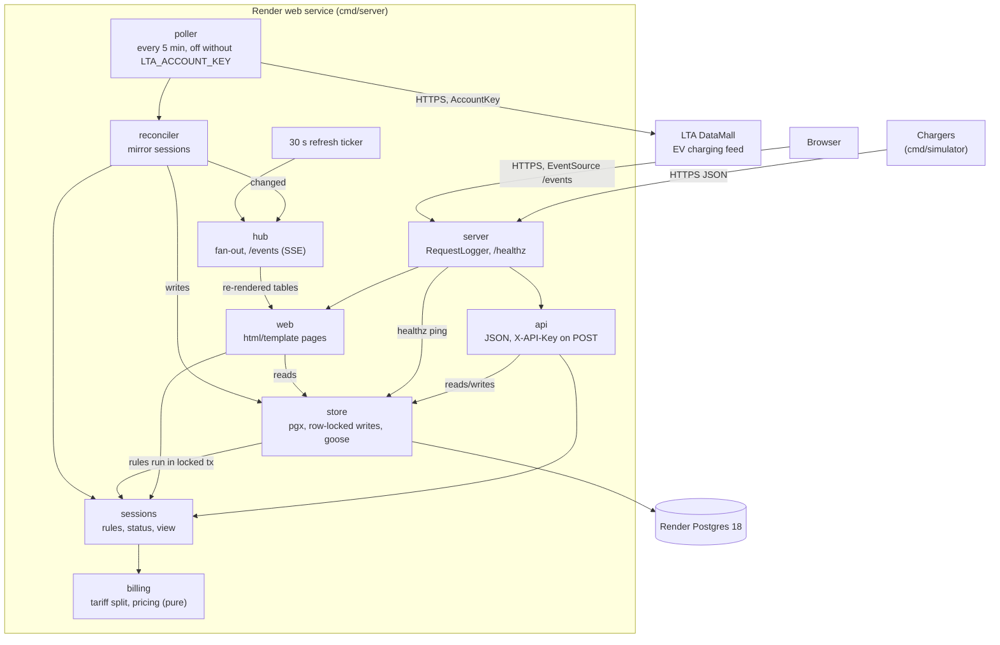
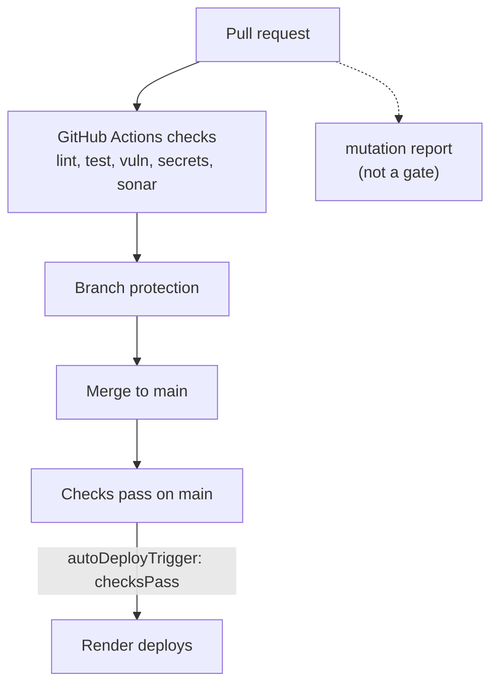

# EV Billing

A small Go service that bills EV charging sessions on a Singapore peak/off-peak tariff: 62 cents per kWh from 07:00 to 23:00 and 48 cents per kWh from 23:00 to 07:00 (`Asia/Singapore`). Chargers report meter readings over a JSON API; a server-rendered status page lists the newest sessions and shows each session's cost split by tariff window. A session that crosses a tariff boundary is split in proportion to time.

Live: https://ev-billing.onrender.com (free tier, see [Deployment](#deployment)).

## Architecture



Delivery path:



### How the live mirror flows

At startup and then every 5 minutes, `datamall` fetches the EV charging batch file (a link request with the `AccountKey` header, then a download of the file without it). `mirror` keeps the connectors at the watched postal codes, estimates their power, and the reconciler compares the occupied ones with the open mirror sessions in the database, starting, extending and stopping sessions through `store`. When a cycle changes something it publishes to the `live` hub; the hub also receives a signal every 30 s so relative times stay current. Each open `/events` stream (kept open with a heartbeat every 25 s) re-renders the list (or detail) fragment and sends it; `/static/live.js` swaps it into the page.

### How a request flows

`POST /api/sessions/{id}/meter-values`: `server.RequestLogger` assigns a request ID and logs the request when it finishes. `api` checks `X-API-Key` in constant time, then decodes the body strictly (unknown fields, trailing data and bodies over 1 MiB are rejected). `store` opens a transaction and locks the session row with `SELECT ... FOR UPDATE`, loads the stored readings, and calls the pure rules in `sessions` (ordering, duplicates, limits). If the rules accept the reading, `store` inserts it and commits. `sessions` and `billing` then compute the status and the bill from the stored readings, and `api` returns the session as JSON (201 for a new reading, 200 for a duplicate). Rule failures map to 404, 409 or 422 with the `{"error": {"code", "message"}}` body.

## Packages

| Package | Responsibility |
|---|---|
| `cmd/server` | Loads config, connects to Postgres, runs migrations, serves HTTP, shuts down on SIGTERM/SIGINT |
| `cmd/simulator` | Replays fake chargers against a running server |
| `internal/billing` | Pure tariff split and pricing in integer cents and Wh; no I/O |
| `internal/sessions` | Session rules (start, reading, stop, limits), derived status, and the bill view |
| `internal/store` | Postgres access with pgx, row-locked write transactions, embedded goose migrations |
| `internal/api` | JSON handlers and `X-API-Key` middleware |
| `internal/web` | Status pages rendered with `html/template`, the `/events` stream and `/static/live.js` |
| `internal/datamall` | DataMall client (link, then file download) and feed parser; integer watts, no floats |
| `internal/mirror` | Poller, planner, reconciler and retention job for the live mirror |
| `internal/live` | Hub that fans "changed" signals out to streams, the 30 s ticker, and the feed status |
| `internal/server` | Top-level handler: request logging, `/healthz`, graceful serve |
| `internal/reqid` | Carries the request ID through the request context |
| `internal/config` | Reads `PORT`, `DATABASE_URL`, `API_KEY` and the optional mirror variables |
| `internal/sim` | Simulator plans and API client |
| `internal/testdb` | Test database helper |

## Quick start

Prerequisites: Go (version in `go.mod`), Postgres 18 with two databases, `evbilling` and `evbilling_test`, and the tools `make check` calls (`golangci-lint`, `gitleaks`).

```sh
createdb evbilling
createdb evbilling_test

make check   # every local gate
make run     # server on :8080, API_KEY=dev, database evbilling (migrations run at startup)
```

Integration tests read `TEST_DATABASE_URL`. `make test` sets it to `postgres://localhost:5432/evbilling_test?sslmode=disable`; a plain `go test` needs it exported.

Try the API (write endpoints need `X-API-Key`; reads are public):

```sh
# start
curl -s -X POST localhost:8080/api/sessions \
  -H 'X-API-Key: dev' -H 'Content-Type: application/json' \
  -d '{"charger_id":"CP-01","started_at":"2026-11-06T21:40:00+08:00","meter_start_wh":0}'

ID=<id from the response>

# meter value
curl -s -X POST localhost:8080/api/sessions/$ID/meter-values \
  -H 'X-API-Key: dev' -H 'Content-Type: application/json' \
  -d '{"timestamp":"2026-11-06T22:40:00+08:00","meter_wh":7200}'

# stop (this example returns total_cents 825: 595 peak + 230 off-peak)
curl -s -X POST localhost:8080/api/sessions/$ID/stop \
  -H 'X-API-Key: dev' -H 'Content-Type: application/json' \
  -d '{"stopped_at":"2026-11-06T23:40:00+08:00","meter_stop_wh":14400}'

# list the newest 50, or fetch one
curl -s localhost:8080/api/sessions
curl -s localhost:8080/api/sessions/$ID
```

Open http://localhost:8080/ for the status page.

### Simulator

```sh
API_KEY=dev go run ./cmd/simulator -start 2026-11-06T21:40:00+08:00 -speed 600
```

This replays three chargers (`CP-01` to `CP-03`) over 155 minutes at 7.2 kW with a reading every 5 minutes, compressed by `-speed`. Each session crosses the 23:00 boundary and totals $10.27 (595 cents peak plus 432 cents off-peak). While a replay runs, its sessions show as `stale` on the status page (the readings are in the past); each ends `completed` once the simulator stops it. Run `go run ./cmd/simulator -h` for all flags.

## API

The contract is [`api/openapi.yaml`](api/openapi.yaml); handler tests validate real responses against it.

| Method | Path | Auth | Success |
|---|---|---|---|
| POST | `/api/sessions` | `X-API-Key` | 201 |
| POST | `/api/sessions/{id}/meter-values` | `X-API-Key` | 201 new reading, 200 duplicate |
| POST | `/api/sessions/{id}/stop` | `X-API-Key` | 200 (a replay of the same stop also returns 200) |
| GET | `/api/sessions/{id}` | none | 200 |
| GET | `/api/sessions` | none | 200 (newest 50) |
| GET | `/healthz` | none | 200, or 503 if the database ping fails within 2 s |

Status pages: `/` (newest 50), `/sessions/{id}` (segment bar and table) and `/locations` (see [Locations](#locations)). They update live over `GET /events` (Server-Sent Events); without JavaScript a `<noscript>` meta refresh reloads every 3 s.

## Live mirror

The server can mirror real charger occupancy from LTA DataMall's EV charging feed into billed sessions. It polls once at startup and then every 5 minutes. For each watched connector that the feed reports as occupied, it opens a `mirror` session and adds a reading at every poll; when the connector frees, it stops the session. The pages label each row `mirror` or `simulated`, and show a feed status line with the time of the last update.

The feed has no energy data, so energy and cost for mirrored sessions are estimates (MIR-4):

- An occupied connector is assumed to draw constant power: its rated power for AC, capped at 50 kW for DC.
- Energy is capped at 60 kWh per occupancy. A gap in observation (sleep, deploy, feed outage) is never billed (MIR-5), and the cap carries across the sessions it splits.
- The feed's "occupied" also covers reserved and blocked connectors.

Default watched postal codes (68 connectors in the 2026-11-08 sample):

| Postal code | Site | Connectors |
|---|---|---|
| `038983` | GV Suntec City | 28, AC and DC |
| `519612` | Pasir Ris Mall | 20, DC |
| `090032` | Blk 29/32 Telok Blangah Rise HDB car park | 20, AC |

Environment variables (the first three are required, see [Quick start](#quick-start)):

| Variable | Purpose |
|---|---|
| `PORT`, `DATABASE_URL`, `API_KEY` | Required for the server |
| `LTA_ACCOUNT_KEY` | Optional. A DataMall AccountKey; when unset the mirror is off and the server logs that once |
| `DATAMALL_BASE_URL` | Optional. Defaults to `https://datamall2.mytransport.sg`; must be an http or https URL with a host, and is checked at startup even when the mirror is off |
| `MIRROR_POSTAL_CODES` | Optional. Comma-separated postal codes to watch; each entry must be six digits. If they select more than 100 connectors, the first 100 by charger ID are mirrored and a warning is logged |

To run it locally, register for a free DataMall AccountKey, then:

```sh
LTA_ACCOUNT_KEY=<your key> make run
```

The first poll runs at startup; the feed line on http://localhost:8080/ shows the time of the last update. Without `LTA_ACCOUNT_KEY`, `make run` works as before and the feed line says "Live mirror off". The AccountKey is never logged, returned or rendered. Completed mirror sessions are deleted after 14 days; `api` sessions are never deleted automatically.

## Locations

`/locations` shows whether public charging at the watched sites is under-used. It has one card per site in the newest feed observation, and updates live over `/events?view=locations`. Rules LOC-1..7 are in the [Locations spec](docs/superpowers/specs/2026-11-08-locations-design.md).

Observed figures come straight from LTA's occupancy data:

- **Utilization** is busy ÷ (busy + free), summed over the occupancy samples the mirror writes on every applied poll. Out-of-service connectors are not capacity, so they are left out. Time the mirror was not watching (sleep, deploy, feed outage) has no samples, so it never counts as idle. A site whose connectors were all out of service shows `n/a`.
- **The 24-hour strip** is the same ratio by hour of day in Singapore time. Each bar is coloured by the tariff window of its hour. A dotted outline marks an hour with no samples, which is not the same as 0%.
- **The connector grid** shows each connector's latest state: busy (solid), free (outline) or out of service (hatched), with a text count beside it. When the mirror is off or the feed is delayed, the grid is greyed and the count reads "as of HH:MM".
- **The headline** pools busy and free time across the sites that have enough data, so larger sites weigh more. It is not an average of the sites' percentages.

Estimated figures are labelled "est.":

- **Billing sessions** are the mirror sessions started in the window. A gap or the 48 h limit can split one car's stay into more than one.
- **Est. energy** is those sessions' estimated energy (rated power, see [Live mirror](#live-mirror)).
- **Est. value** is each session's energy at its charger's posted price today, applied to the whole window. A charger whose price type is not per kWh or free has no usable price, so its sessions are left out and counted as "price n/a".

The window is the last 14 days, or since the first sample when that is later ("Since 8 Nov · 31 h observed"). A site needs 288 samples (24 h observed) before it is ranked or counted in the headline. Until then it shows "collecting data · N h" and follows the ranked sites, which are ordered least used first.

## Quality gates

`make check` runs the local gates and CI runs the same checks. See [`docs/playbook.md`](docs/playbook.md) for detail.

- **lint**: `gofmt` check, `go vet`, `golangci-lint` (forbids `time.Local`, `errcheck` with `check-blank`).
- **test**: `go test -race`; coverage at least 80% across `internal/...` and at least 95% for `internal/billing`.
- **test-tz**: billing tests under `TZ=UTC` and `TZ=America/New_York`.
- **vuln**: `govulncheck`.
- **secrets**: `gitleaks` over git history and the working tree.
- **sonar**: SonarQube Cloud quality gate (CI only).
- **mutation**: `gremlins` on `internal/billing`; a report, not a blocker (`make mutation`).

## Deployment

[`render.yaml`](render.yaml) is a Render Blueprint with one free Go web service (`ev-billing`) and one free Postgres 18 database (`ev-billing-db`), both in Singapore. The service builds with `go build -o bin/server ./cmd/server`, health-checks `/healthz`, and uses `autoDeployTrigger: checksPass`, so Render deploys only after every required CI check on `main` passes. `DATABASE_URL` comes from the database; `API_KEY` and `LTA_ACCOUNT_KEY` are set in the Render dashboard and are never committed. Migrations run at startup.

Free-tier limits (Render's free-tier terms as of November 2026):

- The free Postgres expires 30 days after creation and is deleted after a 14-day grace period. There are no backups.
- The web service spins down after 15 idle minutes; the next request takes about a minute (cold start). The poller sleeps with it, so an external uptime monitor pings `/healthz` every 5 to 10 minutes; see the [playbook](docs/playbook.md#live-mirror-operations).

## Known limitations

- Sessions starting before 2000-01-01 UTC are rejected (422).
- Meter values are capped at 10^15 Wh.
- At most 10,000 stored readings per session.
- Failed API keys are not rate limited.
- JSON keys are matched case-insensitively (Go `encoding/json`), so `{"TIMESTAMP": ...}` is accepted.
- Out of scope: OCPP, payments, multiple tariffs, tariff changes during a session.

## Documents

- [Spec](docs/superpowers/specs/2026-11-07-ev-billing-design.md): rule IDs (BIL, SES, API, UI, OPS)
- [Plan](docs/superpowers/plans/2026-11-07-ev-billing.md)
- [Locations spec](docs/superpowers/specs/2026-11-08-locations-design.md): rule IDs LOC-1..7 (occupancy samples, utilization, hourly profile, data sufficiency, live connector state, sessions and estimated value, the page)
- [Live mirror spec](docs/superpowers/specs/2026-11-08-live-mirror-design.md): rule IDs MIR-1..12 (poller, scope, observation time, energy estimate, gaps, reconciliation, coexistence with API sessions, charger details, retention, config, lifecycle, occupancies past 48 h) and LIVE-1..4 (event stream, hub, pushed content, page content)
- [Live mirror plan](docs/superpowers/plans/2026-11-08-live-mirror.md)
- [AGENTS.md](AGENTS.md): constraints and rules for coding agents
- [Delivery playbook](docs/playbook.md)
- [AI review log](docs/ai-review-log.md)
