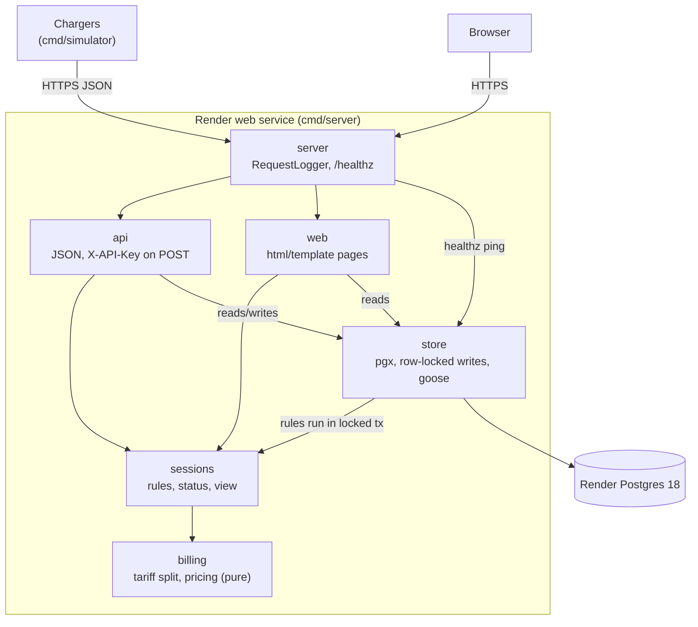
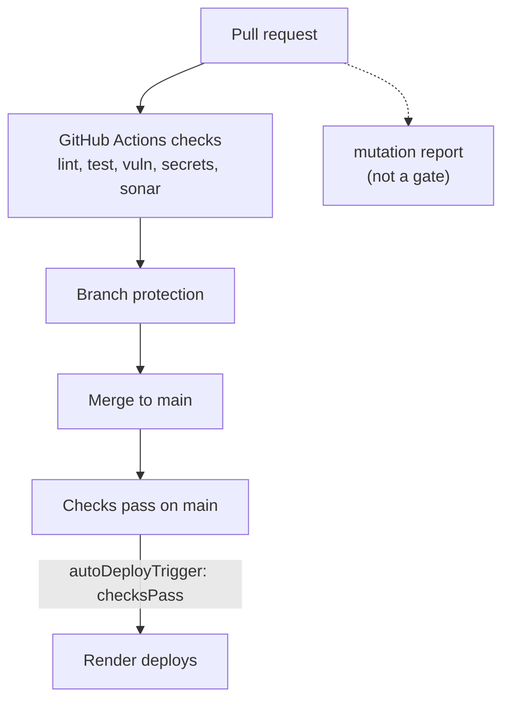

# EV Billing

A small Go service that bills EV charging sessions on a Singapore peak/off-peak tariff: 62 cents per kWh from 07:00 to 23:00 and 48 cents per kWh from 23:00 to 07:00 (`Asia/Singapore`). Chargers report meter readings over a JSON API; a server-rendered status page lists the newest sessions and shows each session's cost split by tariff window. A session that crosses a tariff boundary is split in proportion to time.

Live: https://ev-billing.onrender.com (free tier, see [Deployment](#deployment)).

## Architecture



Delivery path:



### How a request flows

`POST /api/sessions/{id}/meter-values`: `server.RequestLogger` assigns a request ID and logs the request when it finishes. `api` checks `X-API-Key` in constant time, then decodes the body strictly (unknown fields, trailing data and bodies over 1 MiB are rejected). `store` opens a transaction and locks the session row with `SELECT ... FOR UPDATE`, loads the stored readings, and calls the pure rules in `sessions` (ordering, duplicates, limits). If the rules accept the reading, `store` inserts it and commits. `sessions` and `billing` then compute the status and the bill from the stored readings, and `api` returns the session as JSON (201 for a new reading, 200 for a duplicate). Rule failures map to 404, 409 or 422 with the `{"error": {"code", "message"}}` body.

## Packages

| Package | Responsibility |
|---|---|
| `cmd/server` | Loads config, connects to Postgres, runs migrations, serves HTTP, shuts down on SIGTERM/SIGINT |
| `cmd/simulator` | Replays fake chargers against a running server |
| `internal/billing` | Pure tariff split and pricing in integer cents and Wh; no I/O |
| `internal/sessions` | Session rules (start, reading, stop, limits), derived status, and the bill view |
| `internal/store` | Postgres access with pgx, row-locked write transactions, embedded goose migrations |
| `internal/api` | JSON handlers and `X-API-Key` middleware |
| `internal/web` | Status pages rendered with `html/template` |
| `internal/server` | Top-level handler: request logging, `/healthz`, graceful serve |
| `internal/reqid` | Carries the request ID through the request context |
| `internal/config` | Reads `PORT`, `DATABASE_URL`, `API_KEY` |
| `internal/sim` | Simulator plans and API client |
| `internal/testdb` | Test database helper |

## Quick start

Prerequisites: Go (version in `go.mod`), Postgres 18 with two databases, `evbilling` and `evbilling_test`, and the tools `make check` calls (`golangci-lint`, `gitleaks`).

```sh
createdb evbilling
createdb evbilling_test

make check   # every local gate
make run     # server on :8080, API_KEY=dev, database evbilling (migrations run at startup)
```

Integration tests read `TEST_DATABASE_URL`. `make test` sets it to `postgres://localhost:5432/evbilling_test?sslmode=disable`; a plain `go test` needs it exported.

Try the API (write endpoints need `X-API-Key`; reads are public):

```sh
# start
curl -s -X POST localhost:8080/api/sessions \
  -H 'X-API-Key: dev' -H 'Content-Type: application/json' \
  -d '{"charger_id":"CP-01","started_at":"2026-11-06T21:40:00+08:00","meter_start_wh":0}'

ID=<id from the response>

# meter value
curl -s -X POST localhost:8080/api/sessions/$ID/meter-values \
  -H 'X-API-Key: dev' -H 'Content-Type: application/json' \
  -d '{"timestamp":"2026-11-06T22:40:00+08:00","meter_wh":7200}'

# stop (this example returns total_cents 825: 595 peak + 230 off-peak)
curl -s -X POST localhost:8080/api/sessions/$ID/stop \
  -H 'X-API-Key: dev' -H 'Content-Type: application/json' \
  -d '{"stopped_at":"2026-11-06T23:40:00+08:00","meter_stop_wh":14400}'

# list the newest 50, or fetch one
curl -s localhost:8080/api/sessions
curl -s localhost:8080/api/sessions/$ID
```

Open http://localhost:8080/ for the status page.

### Simulator

```sh
API_KEY=dev go run ./cmd/simulator -start 2026-11-06T21:40:00+08:00 -speed 600
```

This replays three chargers (`CP-01` to `CP-03`) over 155 minutes at 7.2 kW with a reading every 5 minutes, compressed by `-speed`. Each session crosses the 23:00 boundary and totals $10.27 (595 cents peak plus 432 cents off-peak). While a replay runs, its sessions show as `stale` on the status page (the readings are in the past); each ends `completed` once the simulator stops it. Run `go run ./cmd/simulator -h` for all flags.

## API

The contract is [`api/openapi.yaml`](api/openapi.yaml); handler tests validate real responses against it.

| Method | Path | Auth | Success |
|---|---|---|---|
| POST | `/api/sessions` | `X-API-Key` | 201 |
| POST | `/api/sessions/{id}/meter-values` | `X-API-Key` | 201 new reading, 200 duplicate |
| POST | `/api/sessions/{id}/stop` | `X-API-Key` | 200 (a replay of the same stop also returns 200) |
| GET | `/api/sessions/{id}` | none | 200 |
| GET | `/api/sessions` | none | 200 (newest 50) |
| GET | `/healthz` | none | 200, or 503 if the database ping fails within 2 s |

Status pages: `/` (newest 50, refreshes every 3 s) and `/sessions/{id}` (segment bar and table).

## Quality gates

`make check` runs the local gates and CI runs the same checks. See [`docs/playbook.md`](docs/playbook.md) for detail.

- **lint**: `gofmt` check, `go vet`, `golangci-lint` (forbids `time.Local`, `errcheck` with `check-blank`).
- **test**: `go test -race`; coverage at least 80% across `internal/...` and at least 95% for `internal/billing`.
- **test-tz**: billing tests under `TZ=UTC` and `TZ=America/New_York`.
- **vuln**: `govulncheck`.
- **secrets**: `gitleaks` over git history and the working tree.
- **sonar**: SonarQube Cloud quality gate (CI only).
- **mutation**: `gremlins` on `internal/billing`; a report, not a blocker (`make mutation`).

## Deployment

[`render.yaml`](render.yaml) is a Render Blueprint with one free Go web service (`ev-billing`) and one free Postgres 18 database (`ev-billing-db`), both in Singapore. The service builds with `go build -o bin/server ./cmd/server`, health-checks `/healthz`, and uses `autoDeployTrigger: checksPass`, so Render deploys only after every required CI check on `main` passes. `DATABASE_URL` comes from the database; `API_KEY` is set in the Render dashboard and is never committed. Migrations run at startup.

Free-tier limits (Render's free-tier terms as of November 2026):

- The free Postgres expires 30 days after creation and is deleted after a 14-day grace period. There are no backups.
- The web service spins down after 15 idle minutes; the next request takes about a minute (cold start).

## Known limitations

- Sessions starting before 2000-01-01 UTC are rejected (422).
- Meter values are capped at 10^15 Wh.
- At most 10,000 stored readings per session.
- Failed API keys are not rate limited.
- JSON keys are matched case-insensitively (Go `encoding/json`), so `{"TIMESTAMP": ...}` is accepted.
- Out of scope: OCPP, payments, multiple tariffs, tariff changes during a session.

## Documents

- [Spec](docs/superpowers/specs/2026-11-07-ev-billing-design.md): rule IDs (BIL, SES, API, UI, OPS)
- [Plan](docs/superpowers/plans/2026-11-07-ev-billing.md)
- [AGENTS.md](AGENTS.md): constraints and rules for coding agents
- [Delivery playbook](docs/playbook.md)
- [AI review log](docs/ai-review-log.md)
